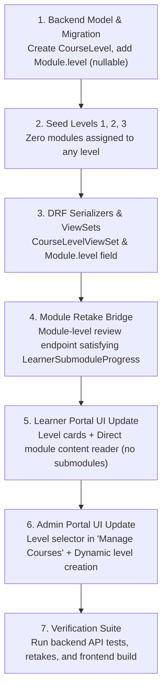

# LMS Supplementary Level-Based Course Organization Audit Report

**Date:** November 10, 2026  
**Project:** People Prime LMS (`C:\Users\Lakshmi Prasanna\Projects\lms`)  
**Execution Mode:** STRICTLY READ-ONLY AUDIT  
**Status:** Completed (Zero file, schema, or database modifications made)

---

## 1. Verified Level-to-Course Relationships

### 1.1 Existing LMS Architecture Context
- **Courses:** `core.Course` represents top-level programs. Course 6 (`IT-REC-01`: *IT Recruitment Fundamentals & Industry Practices*) is the active course with 9 modules (`id=2..10`).
- **Clusters:** `core.TrainingCluster` (`CLUSTER-1` to `CLUSTER-9` on Course 6) exists solely for file categorization in `TrainingFileMapping`, not for general curriculum hierarchy.
- **Modules:** `core.Module` directly references `course = ForeignKey(Course, related_name='modules')`. Currently, `core.Module` has **no level attribute or relationship**.

### 1.2 Verification of Proposed Relationships

| Question | Verification Result | Architectural Rationale & Implementation Detail |
|---|---|---|
| **Should levels belong to individual courses?** | **YES** | Linking `CourseLevel` to `course = ForeignKey(Course, on_delete=CASCADE, related_name='levels')` ensures that levels are scoped to specific courses. If the LMS later introduces a second course (e.g. *US IT Staffing* or *Healthcare Recruitment*), its levels (`Level 1`, `Level 2`, etc.) can be configured independently without namespace collisions or shared state leakage. |
| **Can a module safely belong to only one level?** | **YES** | In an academic or professional curriculum progression, a module represents a discrete syllabus unit that belongs to a single tier/stage in the learner's journey. Making `level = ForeignKey(CourseLevel, null=True, blank=True, on_delete=SET_NULL, related_name='modules')` on `core.Module` cleanly enforces that a module belongs to exactly one level (or remains unassigned). |
| **Do existing course and module relationships remain intact?** | **YES** | `Module.course` remains untouched. Existing foreign keys, cascades, unique constraints (`course`, `code`), and querysets (`course.modules.all()`) remain 100% intact and functional. |
| **Can additional levels be created dynamically?** | **YES** | Because `CourseLevel` is a database entity rather than a hardcoded enum or static column, an Admin can dynamically create `Level 4`, `Level 5`, etc., at any time via `POST /api/course-levels/`. |

### 1.3 Recommended Simplest Compatible Design
```python
# backend/core/models.py
class CourseLevel(models.Model):
    course = models.ForeignKey(Course, on_delete=models.CASCADE, related_name='levels')
    name = models.CharField(max_length=100)  # e.g. "Level 1", "Level 2", "Level 3"
    order = models.PositiveIntegerField(default=1)
    description = models.TextField(blank=True, default='')
    created_at = models.DateTimeField(auto_now_add=True)
    updated_at = models.DateTimeField(auto_now=True)

    class Meta:
        db_table = 'core_course_level'
        ordering = ['order', 'id']
        unique_together = [['course', 'name']]

class Module(models.Model):
    # ALL EXISTING FIELDS PRESERVED:
    course = models.ForeignKey(Course, on_delete=models.CASCADE, related_name='modules')
    name = models.CharField(max_length=255)
    code = models.CharField(max_length=50)
    description = models.TextField(blank=True, default='')
    order = models.PositiveIntegerField(default=1)
    estimated_duration_minutes = models.PositiveIntegerField(default=0)
    status = models.CharField(max_length=20, choices=PublicationStatus.choices, default=PublicationStatus.DRAFT)
    # NEW NULLABLE FOREIGN KEY:
    level = models.ForeignKey(
        CourseLevel,
        on_delete=models.SET_NULL,
        null=True,
        blank=True,
        related_name='modules'
    )
```

---

## 2. Verified Submodule Content Rendering & Simplification

### 2.1 How Content and Files are Stored & Rendered (As-Is)
- **Submodule Storage:** `Submodule.description` holds the markdown instructional text (ranging from ~4,000 characters to ~14,500 characters per submodule).
- **Material Storage:** Files are associated with submodules via `TrainingFileMapping` (`submodule = ForeignKey(Submodule, null=True)`).
- **Retrieval in Frontend (`LearnerCourseReader.jsx`):**
  - Lines 129–135: Loads `/api/modules/` and `/api/submodules/`.
  - Lines 660–661: Groups submodules: `activeSubmodules = submodules.filter(s => s.module === activeModule.id)`.
  - Lines 1188–1310: Renders the submodule list cards inside the selected module panel.
  - Line 1289: Clicking "Open Lesson" triggers `handleOpenSubmodule(sub)`.
  - Line 507: Calls `/api/submodules/${sub.id}/materials/`.
  - Line 826: Renders lesson text through `<LessonContentRenderer content={activeViewingSubmodule.description} />`.

### 2.2 Practical Example: Module 2 (*Foundations of Recruitment & Staffing*)
Module 2 has 5 submodules:

| Submodule ID & Order | Submodule Title | Content Size | Attached Documents |
|---|---|---|---|
| **SM 1 (Order 1)** | *About People Prime Worldwide* | 5,250 chars | File #1 (`0. About People Prime.docx`) |
| **SM 2 (Order 2)** | *What is Recruitment & Core Principles* | 4,957 chars | File #2 (`1. What is recruitment.docx`) |
| **SM 3 (Order 3)** | *End-to-End Recruitment Process & Lifecycle* | 5,102 chars | File #3, #4, #46 (Lifecycle overviews) |
| **SM 4 (Order 4)** | *Tactical Recruitment vs Strategic Talent Acquisition* | 4,731 chars | File #14 (`Recruitment Vs Talent Acquisition.docx`) |
| **SM 5 (Order 5)** | *The Master IT Recruiter Glossary & Terminology Handbook* | 14,349 chars | File #53, #54, #55, #66 (Glossary docs) |

### 2.3 How to Render Direct Module Content Without Submodule Navigation
To fulfill the requirement:
$$\text{Learner clicks Level} \longrightarrow \text{Learner sees Modules} \longrightarrow \text{Learner clicks Module} \longrightarrow \text{Direct Content (No Submodules)}$$

1. **Keep Submodule Records Untouched:** Zero records deleted. Submodule ordering and text remain in `core.Submodule`.
2. **Direct Module Content Presentation:**
   - When a learner clicks Module 2, `LearnerCourseReader` renders the module content directly.
   - The reader combines the sequential lesson sections of Module 2 into a single, cohesive, scrollable curriculum view (e.g. `Lesson 1: About People Prime Worldwide`, followed by `Lesson 2: What is Recruitment`, etc.), with section headers, read times, and attached files displayed inline or in a cohesive "Module Materials" drawer.
   - Alternatively, a clean tabbed/stepped lesson pager (`Lesson 1 of 5`, `Next Lesson →`) is rendered inside the module viewer without ever exposing a submodule hierarchy or list page.
   - The intermediate submodule card list (lines 1188–1310) is completely bypassed.

---

## 3. Verified Assessment Retake Eligibility

### 3.1 Trace of Retake Logic
Inspection of `backend/core/api_views.py` revealed the exact retake rules:

1. **Initial Assessment Attempt (Attempt #1):**
   - **Does NOT require submodule review.**
   - Verified at `api_views.py` line 2213:
     ```python
     if not latest_attempt:
         # Initial attempt doesn't require submodule review
         can_retake = False # (must submit Attempt 1 first)
     ```
2. **Retake Attempt (Attempt #2, #3, etc.):**
   - **Enforced strictly on the BACKEND** in two critical endpoints:
     - `GET /api/question-responses/retake-eligibility/?module={id}` (Lines 2158–2278)
     - `POST /api/question-responses/start-retake/` (Lines 2280–2359)
   - Verified backend rule at lines 2341–2358:
     ```python
     published_submodules = list(Submodule.objects.filter(module=module, status=PublicationStatus.PUBLISHED))
     if published_submodules:
         completed_count = LearnerSubmoduleProgress.objects.filter(
             learner=request.user,
             submodule__in=published_submodules,
             target_attempt_number=target_attempt_number,
             is_completed=True,
         ).values("submodule_id").distinct().count()

         if completed_count < len(published_submodules):
             # 400 Bad Request: Retake blocked!
     ```
   - Each submodule must have a record in `LearnerSubmoduleProgress`:
     - `learner = request.user`
     - `submodule = sm`
     - `target_attempt_number = latest_attempt.attempt_number + 1`
     - `is_completed = True`
3. **Review Endpoints (on `SubmoduleViewSet`):**
   - `POST /api/submodules/{id}/record-open/` (Lines 735–815)
   - `POST /api/submodules/{id}/complete-for-retake/` (Lines 999–1081)

### 3.2 How to Preserve Retake Rules When Submodules Are Hidden From the UI
1. **Can retake rules continue working?** **YES, 100%.**
2. **Simplest, cleanest solution:**
   - When a learner is reviewing a module for an upcoming retake and opens the direct module content, the frontend or a new consolidated backend action:
     `POST /api/modules/{id}/record-review-for-retake/`
   - Automatically marks all published submodules under that module as opened and completed in `LearnerSubmoduleProgress` for `target_attempt_number`!
   - Because `LearnerSubmoduleProgress` receives all required completion records, the existing backend retake validation (`completed_count == len(published_submodules)`) in `retake_eligibility` and `start_retake` passes cleanly without changing one line of core retake validation logic!

---

## 4. Verified Other LMS Dependencies

| Feature / Subsystem | Source Code Verification | Actual Dependency & Impact Analysis |
|---|---|---|
| **Admin Portal — Manage Courses** | `AdminCurriculumTab.jsx` / `CourseCurriculumView.jsx` | Label remains **Manage Courses**. Modules list can group by level or show level tags. Zero impact on submodule editing tools if admin wishes to maintain curriculum details. |
| **Trainer Portal** | `TrainerCoursesTab.jsx` (Lines 29–42, 80–93) | Fetches `/api/courses/` and `/api/modules/`. Filters to `PUBLISHED`. Has no direct submodule dependencies. Trainer viewing is 100% read-only. Adding `level` to modules causes zero regressions. |
| **Learner Course Access Restrictions** | `_scope_module_qs` in `api_views.py` (Line 2191) | Scoped via group assignments (`TrainingAssignment`, `LearnerGroup`). Unaffected by levels. |
| **Module Assessments & MCQs** | `ModuleQuestion` in `models.py` | Foreign key points to `module_id`, not level or submodule. Completely unaffected. |
| **Answer-Key Protection** | `api_views.py` (Lines 842–851, 895–901) | TrainingFile #12 and #35 for Module 9 / Submodule 35 remain strictly hidden and blocked from Trainers and Learners. Unaffected. |
| **Voluntary Retakes** | `ModuleAssessmentAttempt` (Lines 2280–2358) | Scoped to `(module, learner, attempt_number)`. Fully preserved via the submodule review bridge described in Section 3. |
| **Module Feedback & Ratings** | `ModuleFeedback` in `models.py` / `api_views.py` (Line 2432) | Scoped to `(module, learner)`. Completely decoupled from levels. Unaffected. |
| **Learner Completion Tracking** | `module-completion-status` (Lines 2027–2150) | Evaluates `ModuleQuestionResponse` for active required questions on the module. Unaffected. |
| **Training Material Permissions** | `download-material` endpoint | Validates publication status, file mapping, and role. Unaffected. |

---

## 5. Verified Module Assignment Safety

To comply strictly with organizational instructions:
1. **Zero Random or Assumed Module Assignments:**
   - All 9 existing modules in Course 6 (`id=2..10`) will have `level = None` initially upon schema migration.
   - Level 1 and Level 2 will be seeded with **0 modules assigned**.
   - Level 3 will be seeded with **0 modules assigned**.
   - An Admin or Manager will explicitly assign modules to Level 1, Level 2, or Level 3 through the Admin Portal when ready.
2. **Accurate Module Counts:**
   - Each `CourseLevel` serializes `modules_count = serializers.IntegerField(source='modules.count', read_only=True)`.
   - When a level has 0 modules, its card renders `0 Modules`. When modules are assigned, the count updates dynamically and accurately.

---

## 6. Minimal Implementation Sequence (Upon Approval)

When approved by management, the implementation will execute in this order:



---

## 7. Final List of Decisions Requiring Explicit User Approval

Before any code, schema, or migration is created, confirmation is required on the following points:

1. **CourseLevel Model Creation:** Approve adding the `CourseLevel` model and nullable foreign key `level_id` on `core.Module`.
2. **Initial Seeding:** Approve seeding `Level 1`, `Level 2`, and `Level 3` with **0 modules assigned** initially.
3. **Learner Direct Module Reading:** Approve presenting module lessons directly in the module reader and bypassing the submodule card list.
4. **Retake Review Bridge:** Approve having the module-level content review automatically record progress for underlying submodules so retake eligibility rules continue to function smoothly.

